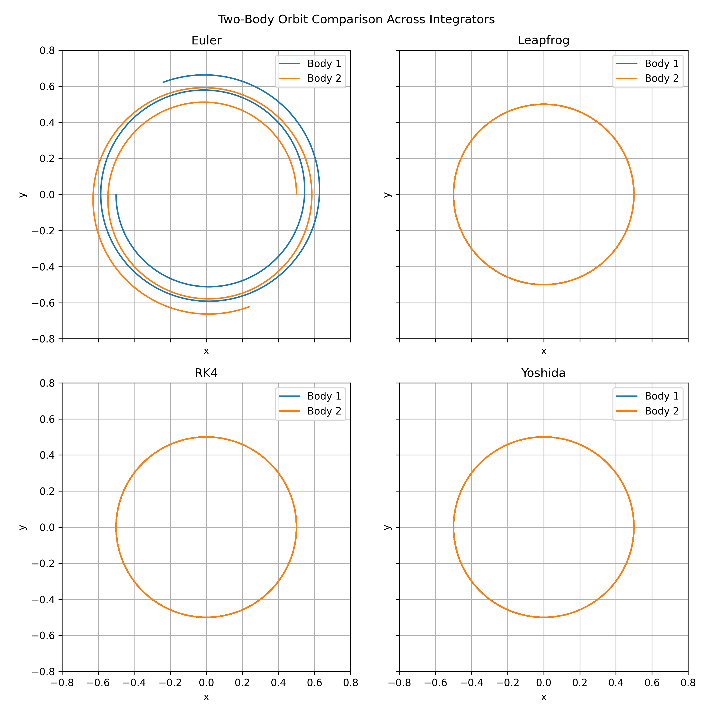
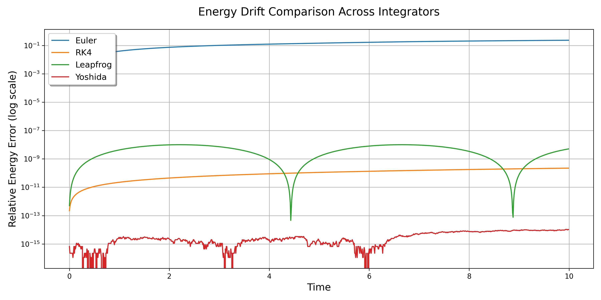
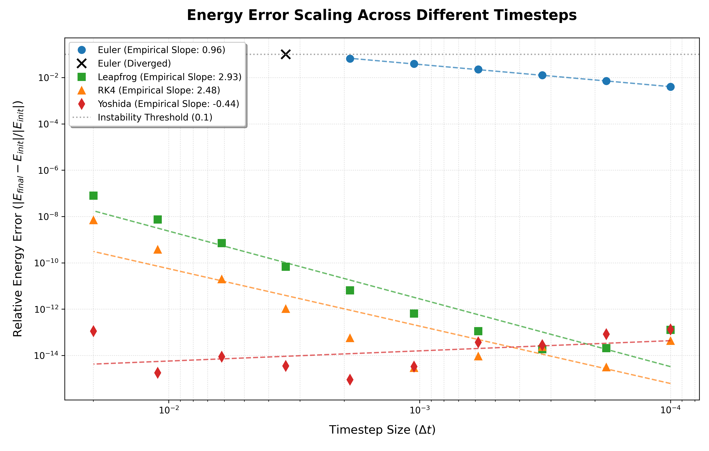
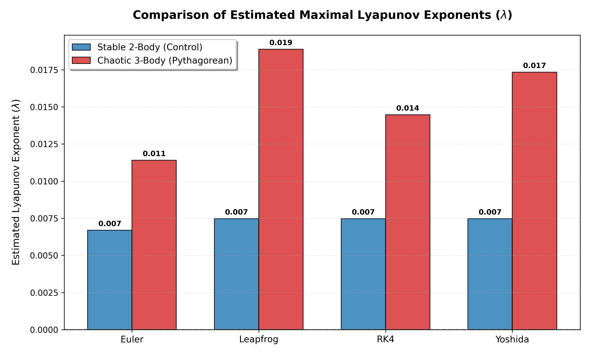
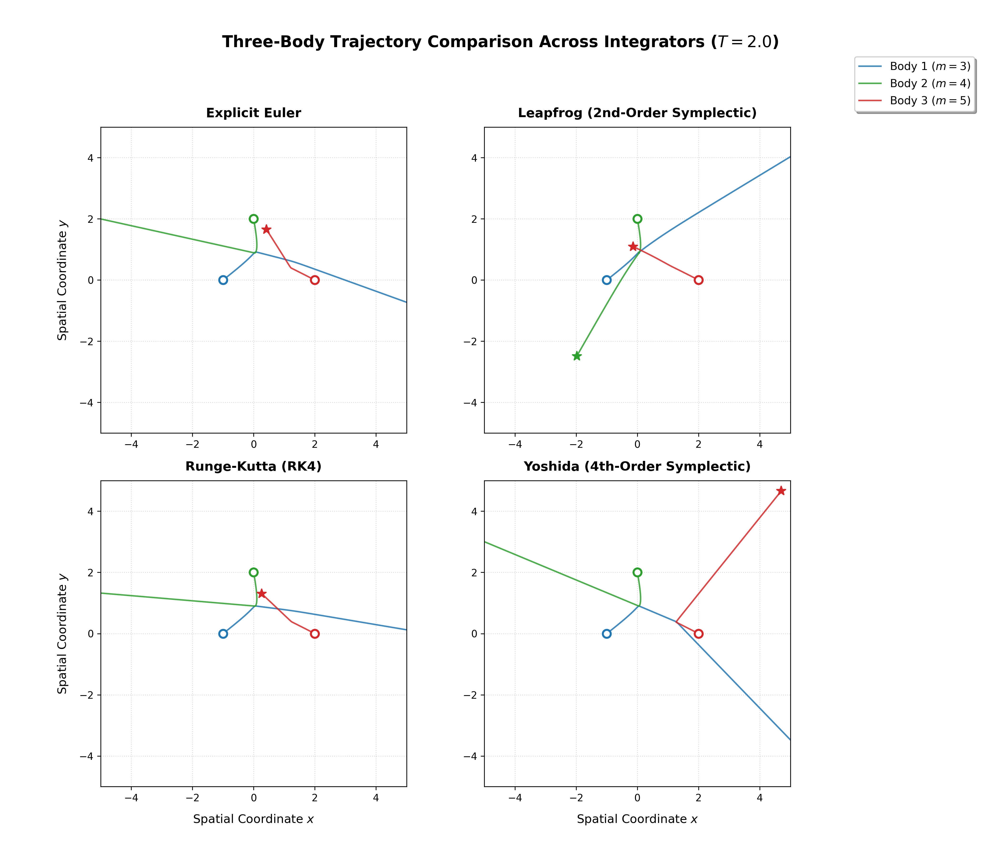
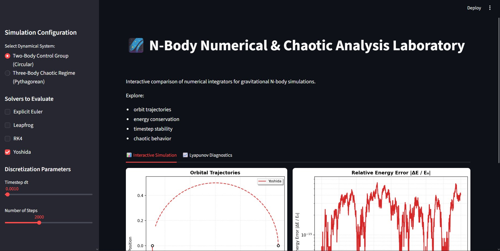
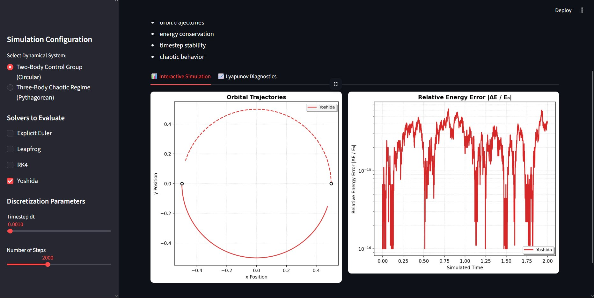
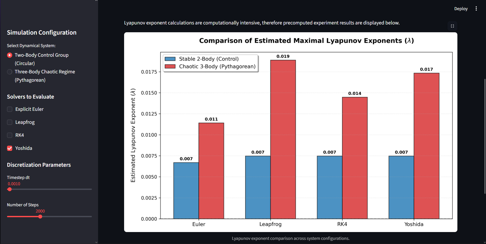

<div align="center">

# 🌌 Gravitational N-Body Numerical Analysis

**A project exploring how the choice of numerical integration affects the accuracy and stability of gravity simulations.**

[](https://python.org)
[](https://numpy.org)
[](https://streamlit.io)
[](https://pytest.org)
[](LICENSE)

_Undergraduate Computer Science Dissertation · Scientific Computing & Numerical Analysis_

</div>

---

## What is this project about?

This project simulates how objects move under gravity — like planets orbiting a star — and tests four different methods for calculating those movements step by step. The main question is: **does the numerical method you choose matter, and if so, how much?**

The short answer is: a lot. Some methods slowly leak energy into the simulation and cause orbits to spiral outward. Others preserve stable orbital behaviour over long simulation intervals. The experiments here show exactly where each method succeeds and fails.

All results can also be explored through a [Streamlit web app](#interactive-app) — pick a solver, drag a slider, and watch orbits and energy errors update live in your browser. No code needed.

### Results Summary

| Method       | Order | Keeps energy stable? |  Orbit error   |      Energy drift      | Stable runs |
| ------------ | :---: | :------------------: | :------------: | :--------------------: | :---------: |
| **Euler**    |  1st  |          ✗           | `1.66 × 10⁻¹`  |     `2.23 × 10⁻²`      |    6/10     |
| **Leapfrog** |  2nd  |          ✓           | `2.48 × 10⁻⁵`  | bounded `9.99 × 10⁻⁹`  |    10/10    |
| **RK4**      |  4th  |          ✗           | `4.15 × 10⁻¹⁰` |     `2.22 × 10⁻¹¹`     |    10/10    |
| **Yoshida**  |  4th  |          ✓           | `7.18 × 10⁻⁹`  | bounded `1.07 × 10⁻¹⁴` |    10/10    |

> **Key takeaway:** Yoshida keeps energy error near the absolute limit of what a computer can represent (~10⁻¹⁵). That's about 13 orders of magnitude better than Euler. RK4 is very precise in the short term but slowly drifts over time, making it less suitable for extremely long-term energy-conserving simulations.

---

## Experiments & Results

### Experiment 01 — Do the orbits stay circular?

Two objects orbit each other. After many steps, do their paths close back into a circle, or do they drift?



Euler's orbit visibly spirals outward due to accumulated numerical energy error. The other three methods produce clean closed circles.

---

### Experiment 02 — How much does energy change over time?

A good simulation should keep the total energy of the system constant. This experiment tracks how much energy is gained or lost.



- **Euler** drifts steadily upward — the error just keeps growing
- **RK4** drifts too, but much more slowly
- **Leapfrog** bounces up and down but stays within a fixed range — it never runs away
- **Yoshida** remains near the floating-point noise floor throughout the simulation, with only small fluctuations caused by finite-precision roundoff effects

---

### Experiment 03 — What happens when you use smaller time steps?

A smaller time step means more calculations per second of simulated time. Reducing the timestep should improve numerical accuracy, but the extent of that improvement depends on the integrator.



The experiment confirmed the expected convergence behaviour of each integrator as the timestep was reduced.

- Euler showed the largest sensitivity to timestep size, with error decreasing slowly as Δt became smaller.
- Leapfrog demonstrated significantly improved stability and error reduction due to its second-order symplectic formulation.
- RK4 achieved extremely small short-term errors before approaching floating-point precision limits.
- Yoshida rapidly reached the machine-precision noise floor (~10⁻¹⁵), where further timestep reduction no longer produced meaningful accuracy improvements.

The experiment also demonstrates a practical limitation of high-order integrators: once truncation error falls below floating-point roundoff error, reducing the timestep further no longer improves simulation accuracy.

---

### Experiment 04 — Can the methods detect chaos?

Chaotic systems are ones where tiny differences in starting position grow into completely different outcomes. This experiment checks whether each method correctly identifies chaotic vs. stable systems.



| Setup          | Euler | Leapfrog  |  RK4  | Yoshida |
| -------------- | :---: | :-------: | :---: | :-----: |
| Stable 2-body  | 0.007 |   0.007   | 0.007 |  0.007  |
| Chaotic 3-body | 0.011 | **0.019** | 0.015 |  0.017  |

All four methods correctly show higher chaos in the three-body case. Euler gives a lower reading because it dampens the simulation — it makes things look _less_ chaotic than they really are.

---

### Experiment 05 — Three bodies in chaos

Three objects with masses 3, 4, and 5 are placed at the corners of a right triangle and released. This is a well-known chaotic setup with no stable solution.



After just 2 simulated time units, all four methods predict completely different positions. This isn't a flaw — it's the nature of chaos. Even tiny rounding differences get amplified until the results diverge entirely.

---

## Project Structure

```
nbody-numerical-analysis/
│
├── src/
│   ├── physics/
│   │   ├── body.py              # Stores position, velocity, and mass for each object
│   │   └── system.py            # Calculates gravitational pull between all pairs of objects
│   │
│   ├── integrators/
│   │   ├── euler.py             # Euler      — simple but unstable
│   │   ├── leapfrog.py          # Leapfrog   — stable, good for long runs
│   │   ├── rk4.py               # RK4        — very accurate but for short-term runs
│   │   └── yoshida.py           # Yoshida    — best long-term energy conservation
│   │
│   ├── diagnostics/
│   │   ├── energy.py            # Tracks how much energy is gained or lost
│   │   └── lyapunov.py          # Measures how quickly nearby paths diverge
│   │
│   └── utils/
│       └── initial_conditions.py  # Sets up the starting positions and speeds
│
├── experiments/                 # The five numbered experiments
├── tests/                       # Automated tests (pytest)
├── app/
│   └── streamlit_app.py         # Interactive browser interface
│
└── dissertation/
    ├── figures/                 # All plots generated by the experiments
    ├── Streamlit_screenshots/   # Screenshots used in this README
    └── text/                    # Full terminal output logs
```

---

## The Four Methods

### Euler

The most basic approach. Each step, move the object based on its current speed, then update the speed based on the current gravitational pull.

```
new position = position + velocity × Δt
new velocity = velocity + acceleration × Δt
```

Fast to compute, but adds energy to the simulation over time. Only useful as a teaching example.

### Leapfrog

A smarter version that updates position and velocity at slightly offset times, which cancels out much of the error.

```
half-step velocity = velocity + acceleration × Δt/2
new position       = position + half-step velocity × Δt
new velocity       = half-step velocity + new acceleration × Δt/2
```

Energy stays within a fixed range forever. A solid choice for long simulations.

### Runge-Kutta 4 (RK4)

Takes four sample points within each time step to get a much more accurate estimate of where the object should end up.

Very accurate in the short term, but energy slowly drifts over long runs. Good when you need precision over a short window.

### Yoshida

A more advanced version of Leapfrog that uses seven internal stages per step to reach the same accuracy level as RK4, while still keeping long-term energy error tightly bounded.

One of the strongest choices for long-term Hamiltonian simulations. Reference: Yoshida, H. (1990). _Physics Letters A._

---

## Installation

```bash
git clone https://github.com/yourusername/nbody-numerical-analysis.git
cd nbody-numerical-analysis
pip install -r requirements.txt
```

**Requires:** `numpy`, `matplotlib`, `scipy`, `pytest`, `streamlit`

---

## Running the Code

### Run an experiment

```bash
python -m experiments.01_two_body_orbit
python -m experiments.02_energy_drift_comparison
python -m experiments.03_timestep_sensitivity
python -m experiments.04_lyapunov_analysis
python -m experiments.05_three_body_chaos
```

Plots are saved to `dissertation/figures/`.

### Run the tests

```bash
python -m pytest tests/ -v
```

### Launch the interactive app

```bash
python -m streamlit run app/streamlit_app.py
```

---

## Tests

The test suite covers all four layers of the project — physics, integration, diagnostics, and data validation.

**`test_body.py`** — checks that a `Body` object stores its mass, position, and velocity correctly when created.

**`test_system.py`** — validates the gravitational physics. Confirms that two bodies pull toward each other in the right directions, that the total force on the system is zero (Newton's third law), and that a bound system has negative total energy. Also checks that passing a 3D position raises an error, since the simulation is 2D only.

**`test_integrators.py`** — tests each solver's correctness and relative performance:

- All four integrators (Euler, Leapfrog, RK4, Yoshida) are checked: a single body with no gravitational neighbours should move in a straight line — position and velocity are verified after one step.
- Energy conservation is tested across all meaningful pairs: Leapfrog beats Euler, Yoshida beats Euler, and Yoshida beats Leapfrog — all after 1000 steps.
- The initial energy of a two-body circular orbit is verified against the known analytical value (−0.5) to within 10⁻¹⁰.
- Angular momentum is confirmed to remain constant to within 10⁻⁶ after 1000 steps with Leapfrog.

**`test_diagnostics.py`** — checks the analysis tools:

- `relative_energy_error` returns the correct fraction (e.g. 10 → 11 gives 0.1).
- The Lyapunov exponent for a stable two-body system comes back below 0.5, confirming the estimator doesn't flag stable orbits as chaotic.

---

## Interactive App

The Streamlit app lets you run and compare simulations directly in your browser — no code needed.




**What you can do:**

- **Pick a system** — choose between a stable two-body circular orbit or the chaotic Pythagorean three-body problem
- **Select solvers** — tick any combination of Euler, Leapfrog, RK4, and Yoshida to run side by side
- **Adjust the timestep** — drag the `dt` slider from 0.0005 to 0.05 and watch how accuracy changes
- **Change the number of steps** — control how long the simulation runs (100 to 5000 steps)
- **Read the orbit plot** — see whether paths close into circles or spiral outward
- **Read the energy error plot** — log-scale chart showing how much energy each method gains or loses over time
- **Switch to the Lyapunov tab** — view precomputed chaos measurements for both system types



The Lyapunov tab shows a bar chart comparing the estimated chaos score (λ) for each solver across two setups: the stable two-body orbit and the chaotic three-body problem. Higher bars mean the solver detected more chaos. Because these calculations are slow to run live, the results are precomputed — run `python -m experiments.04_lyapunov_analysis` first to generate them.

---

## Key Concepts

| Term                         | Plain explanation                                                                                                           |
| ---------------------------- | -------------------------------------------------------------------------------------------------------------------------- |
| **Symplectic integrator**    | A method that keeps the total energy of the simulation stable over time, rather than letting it drift                      |
| **Energy drift**             | When a simulation slowly gains or loses energy it shouldn't — a sign the method is introducing errors                      |
| **Timestep**                 | How much simulated time passes per calculation. Smaller = more accurate but slower                                         |
| **Lyapunov exponent**        | A number that measures how chaotic a system is — how fast two nearly identical starting points lead to different outcomes   |
| **Chaos**                    | When tiny differences in starting conditions grow into completely different results                                         |
| **Floating-point precision** | Computers can only store numbers to about 15 decimal places, which sets a hard floor on how accurate any simulation can be |

---

## Technologies

`Python 3.9+` · `NumPy` · `Matplotlib` · `SciPy` · `Streamlit` · `pytest`

---

<div align="center">

_Computer Science Undergraduate Dissertation_  
_Scientific Computing · Numerical Simulation · Computational Physics_

</div>
